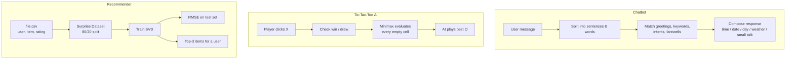

# CodSoft — Artificial Intelligence Internship


Tasks completed during the **CodSoft virtual internship in Artificial Intelligence**: a rule-based chatbot, an unbeatable Tic-Tac-Toe AI, and a collaborative-filtering recommendation system.

---

## Tasks at a Glance

| Task | File | Technique | Interface |
|---|---|---|---|
| Rule-based Chatbot | `chatbot.py` | Keyword and intent matching | Tkinter GUI |
| Tic-Tac-Toe AI | `tictactoe.py` | Minimax search | Tkinter GUI |
| Recommendation System | `recommendationSys.py` | Matrix factorisation (SVD) | Console |

## Workflow



---

## 1. Rule-based Chatbot (`chatbot.py`)

A desktop chatbot built with **Tkinter** that answers using pattern matching.

- Recognises **greetings**, **farewells** and intents: questions, positive and negative sentiment, thanks, "what can you do", safety ("is it safe to go out"), and first-, second- and third-person references.
- Answers with the current **time, date and day** from the system clock and a **weather** reply.
- Handles several sentences in one message (split on commas) and gives a fallback reply when it doesn't understand.
- Saying "bye" closes the window.

## 2. Tic-Tac-Toe AI (`tictactoe.py`)

A Tic-Tac-Toe game with a Tkinter GUI where you (**X**) play against the computer (**O**).

- The AI uses the **Minimax** algorithm to search the full game tree (+1 AI win, −1 player win, 0 draw), so it never loses.
- The game checks all eight winning lines and draws after every move, shows the result in the window, and locks the board once the game is decided.

## 3. Recommendation System (`recommendationSys.py`)

A **collaborative-filtering** recommender built with the [Surprise](https://surpriselib.com/) library.

- **Data:** `file.csv`, 1,000 ratings with columns `user`, `item`, `rating` (1,000 users × 30 movies, one rating per user).
- **Validation:** drops missing or non-numeric ratings and clips ratings into the 1–5 scale (202 ratings in `file.csv` are below 1).
- **Model:** `SVD` matrix factorisation trained on an 80/20 train/test split (`random_state=42`).
- **Evaluation:** prints the RMSE on the test set.
- **Recommendation:** looks up the user id case-insensitively (`User1` → `user1`), predicts a rating for every item the user has not rated yet, and prints the **top 3**.
- **Limitation:** with only one rating per user, SVD has very little signal per user, so predictions stay close to each item's average.

---

## Tech Stack

- **Language:** Python
- **GUI:** Tkinter (standard library)
- **ML:** scikit-surprise (SVD), pandas

## Project Structure

```
CodSoft/
├── chatbot.py             # Task: rule-based chatbot (Tkinter)
├── tictactoe.py           # Task: Tic-Tac-Toe with Minimax AI (Tkinter)
├── recommendationSys.py   # Task: SVD recommendation system
├── file.csv               # Ratings data for the recommender
├── requirements.txt
└── README.md
```

## How to Run

```bash
git clone https://github.com/Gonugunta-Venkata-Jayanth/CodSoft.git
cd CodSoft

# Chatbot and Tic-Tac-Toe: standard library only (Tkinter)
python chatbot.py
python tictactoe.py

# Recommendation system
pip install -r requirements.txt
python recommendationSys.py
```

> Tkinter ships with most Python installers. On Debian/Ubuntu, install it with `sudo apt install python3-tk`.

## Author

**Jayanth Gonugunta Venkata** · [GitHub](https://github.com/Gonugunta-Venkata-Jayanth)
